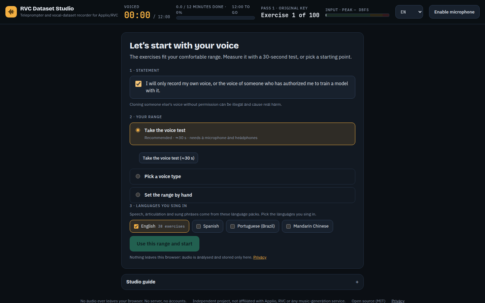
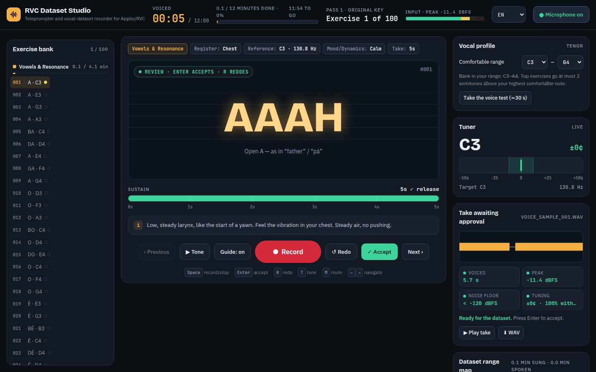

# RVC Dataset Studio

**Find your vocal profile and record a clean dataset for training your own voice model in [Applio](https://github.com/IAHispano/Applio) / RVC — entirely in your browser.**

[Português (Brasil)](README.pt-BR.md) · [Technical guide](docs/GUIDE.md) · [Adding a language](docs/LANGUAGE_PACKS.md) · [Contributing](CONTRIBUTING.md)


- **No audio ever leaves your browser.** No server, no accounts, no cookies, no analytics. Works offline after the first visit.
- **Fits any voice.** A 30-second voice test measures your comfortable range and every exercise is placed inside it — bass to soprano.
- **Balanced vocal registers.** Actively balances chest, mixed/passaggio and falsetto (head voice) so your AI model navigates transitions smoothly without shrieking or cracking on high melodies.
- **Input gain & headroom calibration.** 5-second test warns about digital clipping (> -1 dBFS) and excess background noise (< -24 dBFS) before recording starts.
- **Live prompter cents feedback.** Real-time visual pitch accuracy badge directly on the prompter during takes.
- **Checks every take.** Voiced time, peak and clipping, noise floor and tuning, before you accept it.
- **Shows what is missing.** Range map and register mix bars show seconds recorded per note, coverage percentages, and targeted exercise suggestions.
- **Applio-ready export.** Bundles clean 16/24-bit WAVs, README, and `dataset_info.json` with tailored hyperparameters (RMVPE, index rate, target rate, epochs).

> Independent project. Not affiliated with Applio, RVC, Suno or any music-generation service.
> Only record and clone **your own voice**, or a voice you have clear permission to use.

## How it works

1. **Start with your voice.** Confirm you will only record your own voice (or one you are authorized to use), then take the voice test (siren, speech, comfortable note), pick a voice type or set your range by hand. Choose the languages you sing in.

   

2. **Record.** Put on closed-back headphones, press **Space**, breathe during the count-in, sing or speak along with the karaoke. The reference tone plays your target note; the live tuner shows how close you are.
3. **Review.** Every take gets a quality check. **Enter** accepts, **R** redoes.

   

4. **Fill the gaps.** Watch the range map and aim for 10–15 minutes of voiced audio. Add **My lyrics** to practise lines from your own songs (spoken, fast, slow and sung) — they stay in your browser.
5. **Export.** Download all takes as a ZIP (one WAV per take plus a README) or as one continuous WAV, and train in Applio.

Keyboard: **Space** record/stop · **Enter** accept · **R** redo · **T** reference tone · **M** mute guide · **← →** previous/next.

## Taking the dataset to Applio

1. Unzip into `assets/datasets/YourVoiceName` (no spaces or accents in the path).
2. **Preprocess** at 40 kHz or 48 kHz (match the pretrained model you will use) with automatic slicing. Applio cuts the audio into short chunks again, so the length of each take only matters for your comfort.
3. **Extract** with the `rmvpe` pitch extractor and the `contentvec` embedder (use the same embedder later at inference).
4. **Train** from a pretrained model, saving a checkpoint every 10–50 epochs, then build the index. **Compare checkpoints by ear** instead of trusting a fixed number of epochs.

The [technical guide](docs/GUIDE.md) explains recording technique and the conversion settings (Protect, Index rate, formants) in more detail.

## Privacy

Everything is processed in the page. Takes are stored in your browser's IndexedDB; settings and lyrics in localStorage. Nothing is uploaded. Read the in-app **Privacy** page for details (GDPR included).

## Browser support

Recent Chrome, Edge, Firefox and Safari (desktop and iOS). Recording uses an AudioWorklet with a ScriptProcessor fallback. The microphone requires HTTPS (or `localhost`). See [docs/BROWSER_TESTING.md](docs/BROWSER_TESTING.md).

## Development

```sh
npm install
npm run dev          # http://localhost:5173
npm run check        # lint + type-check + content validation + tests + build
```

| Script | What it does |
| --- | --- |
| `npm run lint` | ESLint |
| `npm run typecheck` | TypeScript, no emit |
| `npm run validate:content` | Validates `content/` against `schema/` |
| `npm test` | Vitest with synthetic signals (pitch, VAD, WAV, placement, range map, lyrics, export) |
| `npm run build` | Static site with service worker in `dist/` |

Stack: Vite + TypeScript + Preact (with signals) + Tailwind (compiled). No runtime CDN; fonts are self-hosted.

```
src/audio      AudioContext, AudioWorklet capture (ScriptProcessor fallback), reference synth
src/analysis   YIN pitch, VAD/levels, FFT/LTAS, WAV, take QC, range map, voice test
src/bank       exercise types, placement in the singer's range
src/lyrics     “My lyrics”: syllables and exercise generation
src/storage    IndexedDB (takes) and settings
src/export     ZIP (fflate, stored) and continuous WAV
src/i18n       interface strings and tips (en = reference, pt-BR)
src/ui         Preact components
content/       exercise bank and language packs (CC0), one folder per language
schema/        JSON Schemas for content/
```

### Languages

- Interface: English (default) and Português (Brasil). `src/i18n/en.ts` is the reference; TypeScript enforces the same keys in every locale.
- Speech packs: English, Português (Brasil), Español and 中文 (Mandarin, with pinyin and tone contours).
- Adding a language: [docs/LANGUAGE_PACKS.md](docs/LANGUAGE_PACKS.md).

## Deploying

The site is fully static. On [Vercel](https://vercel.com): import the GitHub repository, keep the detected Vite settings (build `npm run build`, output `dist`). `vercel.json` adds the security headers: a strict Content-Security-Policy, `Permissions-Policy: microphone=(self)`, HSTS and no-cache for the service worker. Any static host works if you replicate those headers.

## License

Code: [MIT](LICENSE). Exercise bank and language packs (`content/`, `schema/`): [CC0 1.0](content/LICENSE). Bundled fonts: SIL Open Font License 1.1.
