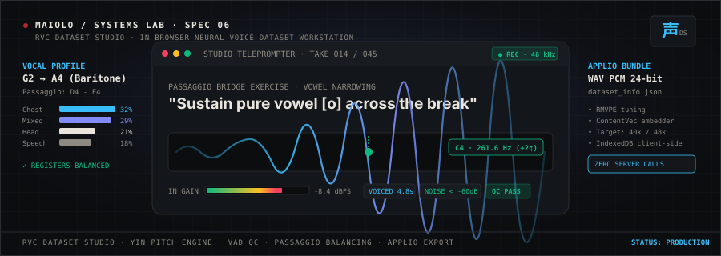
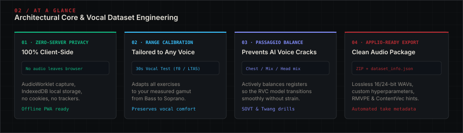
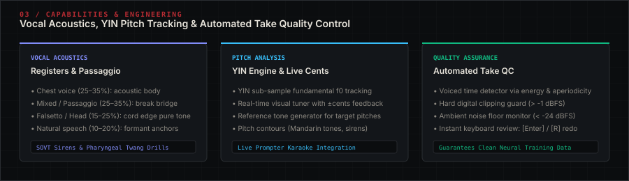
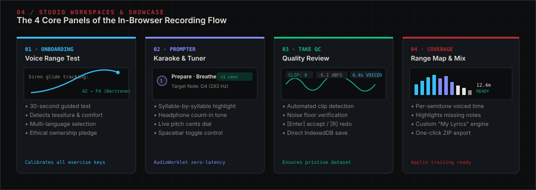
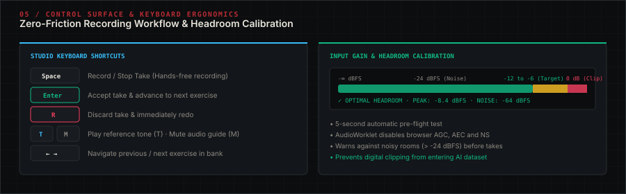
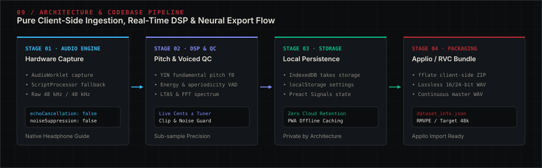
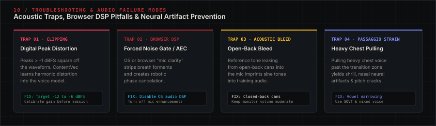
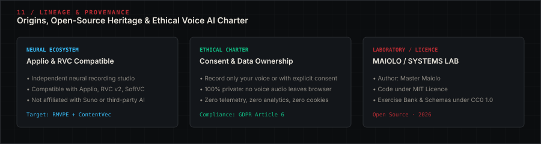

<div align="center">

# RVC DATASET STUDIO

**Browser-Native Vocal Profiling &amp; Clean Dataset Recording Studio for Applio / RVC**

[](https://github.com/mastermaiolo/rvc-dataset-studio)
[](LICENSE)
[](https://developer.mozilla.org/en-US/docs/Web/API/AudioWorklet)
[-10B981?style=flat-square&labelColor=13161A)](docs/GUIDE.md#privacy)
[](https://github.com/IAHispano/Applio)

<br/>

**English (UK)** · [Português (Brasil)](README.pt-br.md) · [Português (Portugal)](README.pt-pt.md) · [Español](README.es-es.md) · [简体中文](README.zh-cn.md)

<br/>



</div>

<br/>

> **In-browser recording studio and vocal analysis workstation**: measures your personal vocal profile, calibrates exercise tessituras, balances vocal registers, and records clean, uncompressed datasets tailored for training voice models in [**Applio**](https://github.com/IAHispano/Applio) and **RVC**.
>
> 🔒 **100% Client-Side Privacy:** No audio ever leaves your browser. Zero backend servers, no accounts, no cookies, no telemetry. Operates entirely offline as a Progressive Web App (PWA).

> [!IMPORTANT]
> **Ethical Voice AI &amp; Ownership Charter:**
> Only record and clone **your own voice**, or a voice for which you have explicit, verifiable consent. This is an independent open-source tool and is not affiliated with Applio, RVC, Suno, or any commercial music generation platform.

---

## 01 / Navigation Index

- [02 / At a Glance](#02--at-a-glance)
- [03 / Capabilities &amp; Engineering](#03--capabilities--engineering)
- [04 / Workspaces &amp; Showcase](#04--workspaces--showcase)
- [05 / Control Surface &amp; Keyboard Ergonomics](#05--control-surface--keyboard-ergonomics)
- [06 / Neural Training &amp; Applio Pipeline](#06--neural-training--applio-pipeline)
- [07 / Privacy &amp; Local Storage Architecture](#07--privacy--local-storage-architecture)
- [08 / Installation &amp; Development](#08--installation--development)
- [09 / Architecture &amp; Codebase Layout](#09--architecture--codebase-layout)
- [10 / Troubleshooting &amp; Failure Modes](#10--troubleshooting--failure-modes)
- [11 / Lineage &amp; Provenance](#11--lineage--provenance)

---

## 02 / At a Glance

Training a high-fidelity Retrieval-based Voice Conversion (RVC) or Applio neural model requires consistent, clean, and register-balanced audio. Amateur recording setups frequently introduce room reverb, clipped waveforms, or pitch cracks caused by straining beyond comfortable tessituras.

RVC Dataset Studio bridges the gap between vocal pedagogy and machine learning: it calibrates every prompt to the singer's measured range, enforces balanced register distribution across the vocal break (*passaggio*), conducts automated take quality assurance, and exports ready-to-train datasets directly to disk.

<br/>

<div align="center">
  
</div>

<br/>

### Key Architectural Strengths

| Architectural Pillar | Technical Implementation | Practical Studio Advantage |
|---|---|---|
| **Zero-Server Client Privacy** | Pure in-browser Web Audio API &amp; IndexedDB local storage | No audio leaves your machine; zero servers, zero cookies, zero tracking |
| **Vocal Profile Calibration** | 30-second guided test measuring tessitura, comfort note &amp; LTAS | Automatically transposes all exercises to your vocal range (Bass to Soprano) |
| **Passaggio &amp; Register Balance** | Target mix: Chest (25–35%), Mixed (25–35%), Head (15–25%), Speech (10–20%) | Prevents AI models from screeching, cracking, or pulling chest weight on high notes |
| **Real-Time YIN Pitch Tuner** | Sub-sample YIN fundamental ($f_0$) tracking with live $\pm\text{cents}$ dial | Immediate visual intonation feedback on the karaoke prompter during takes |
| **Automated Take QC** | Voiced time analysis, digital clipping guard ($> -1\text{ dBFS}$), noise floor | Rejects contaminated takes before they corrupt the neural dataset |
| **Turnkey Applio Packaging** | Bundles 16/24-bit WAVs, README, and `dataset_info.json` via `fflate` | Tailored hyperparameters (RMVPE, ContentVec, target rate, epochs) ready for training |

---

## 03 / Capabilities &amp; Engineering

<br/>

<div align="center">
  
</div>

<br/>

### 1. Vocal Registers, Passaggio &amp; Preventing Model Strain
Neural embedding models (such as ContentVec) struggle when forced to extrapolate outside recorded acoustic domains. If a dataset consists solely of heavy chest voice, then whenever an inference song ascends into the vocal transition zone (*passaggio*, e.g. D4–G4 for male voices), the RVC model artificially pulls chest weight upward. This produces shrill, nasal artifacts, extreme tension, or octave cracks.

RVC Dataset Studio solves this by monitoring and guiding the target register mix:
- **Chest Voice (25–35%):** Core acoustic power, warm fundamental resonance, and speech body.
- **Mixed Voice / Passaggio (25–35%):** The essential bridge across your vocal break. Crucial for realistic song melody conversion.
- **Falsetto / Head Voice (15–25%):** Pure vocal fold edge vibration. Prevents high soft melodies from collapsing into noise.
- **Natural Speech (10–20%):** Conversational formant anchors and diction articulation.

Pedagogical techniques integrated into the exercise bank include:
- *Semi-Occluded Vocal Tract Exercises (SOVPE):* "Ng" sirens and lip trills that equalise subglottic air pressure.
- *Pharyngeal Twang:* "Nay" and "Gee" drills that stimulate crisp vocal fold closure without dragging heavy mass.
- *Vowel Narrowing:* Modifying open vowels toward rounded shapes (e.g. "Ah" $\rightarrow$ "Uh/Oh") near the upper range limit.

### 2. YIN Pitch Tracking &amp; Prompter Karaoke
The studio features a high-precision pitch detection engine based on the **YIN algorithm**, computing fundamental frequency ($f_0$) and aperiodicity in real time.
- **Live Cents Indicator:** A visual pitch badge displays semitone offsets ($\pm\text{cents}$) directly above the text prompter.
- **Reference Pitch Synth:** Plays target pitch tones into closed-back headphones, allowing the singer to lock onto pitch before the take begins.
- **Tone Contours:** Generates dynamic pitch guides for pitch sirens, glides, and tonal languages (e.g. Mandarin four tones).

### 3. Take Quality Assurance &amp; Headroom Calibration
Before recording commences, a 5-second calibration test verifies headroom and ambient acoustics:
- **Digital Clipping Check:** Instantly flags peaks exceeding $-1\text{ dBFS}$.
- **Background Noise Floor:** Ensures ambient noise remains below $-24\text{ dBFS}$ (ideally $<-60\text{ dBFS}$).
- **Voiced Duration:** Validates that the take contains sufficient voiced phonation (not just room silence).
- **Instant Keyboard Review:** Press **Enter** to accept the take or **R** to redo immediately.

---

## 04 / Workspaces &amp; Showcase

<br/>

<div align="center">
  
</div>

<br/>

### The 4 Core Panels of the Recording Flow

| Panel / Workspace | Primary Function | Operational Capabilities |
|---|---|---|
| **01 / Voice Onboarding** | Vocal range test &amp; consent | 30-second guided test (sirens, speech, comfortable note); vocal type classification; language selection |
| **02 / Studio Prompter** | Hands-free recording HUD | Syllable-by-syllable karaoke prompter, count-in metronome, reference audio tone, live tuner badge |
| **03 / Take Review &amp; QC** | Take verification card | Waveform playback, voiced time calculation, peak level in dBFS, background noise check, [Enter] / [R] shortcuts |
| **04 / Dataset Range Map** | Coverage &amp; export manager | Semitone-by-semitone distribution chart, register mix percentages, "My lyrics" generator, ZIP / continuous WAV export |

<br/>

<details>
<summary><strong>Explore Pre-Built Content &amp; Language Packs (Click to Expand)</strong></summary>
<br/>

1. **Exercise Bank (`content/`):**
   Standardized JSON files validated against strict schemas (`schema/`). Covers sustained vowels, pitch glides, interval leaps, rapid diction drills, and register blending.
2. **Speech &amp; Phoneme Packs:**
   Includes dedicated packs for **English**, **Português (Brasil)**, **Español**, and **中文 (Mandarin)** with pinyin transcription and pitch contour mappings.
3. **"My Lyrics" Generator:**
   Allows singers to paste lines from their own original songs. The app automatically segments syllables and generates four exercise variants: spoken natural, sung melody, rapid articulation, and slow sustained phrasing. All custom lyrics remain stored strictly in browser `localStorage`.
4. **Applio Parameter Manifest (`dataset_info.json`):**
   Exported alongside your audio takes, recommending sample rates (40k/48k), RMVPE pitch extraction, ContentVec embedder alignment, and target epoch schedules.

</details>

---

## 05 / Control Surface &amp; Keyboard Ergonomics

<br/>

<div align="center">
  
</div>

<br/>

### Keyboard Shortcuts

Designed for hands-free studio recording while standing at a vocal booth:

| Key | Action | Context |
|---|---|---|
| <kbd>Space</kbd> | **Record / Stop Take** | Starts count-in ("Prepare · Breathe") or stops current take |
| <kbd>Enter</kbd> | **Accept Take** | Saves take to IndexedDB and advances to next exercise |
| <kbd>R</kbd> | **Redo Take** | Discards current recording and immediately restarts take |
| <kbd>T</kbd> | **Play Reference Tone** | Plays synthesized target guide pitch in headphones |
| <kbd>M</kbd> | **Mute Audio Guide** | Mutes or unmutes reference guide tones |
| <kbd>←</kbd> / <kbd>→</kbd> | **Previous / Next Exercise** | Navigates through the exercise bank |

### Headroom &amp; Acoustic Calibration

1. Put on **closed-back headphones** (open-back headphones bleed reference tones into the microphone).
2. Position yourself **15–20 cm** from the microphone with a pop filter.
3. Set interface preamp gain so loudest singing peaks land between **$-12\text{ dBFS}$ and $-6\text{ dBFS}$**. Never trigger digital clipping ($0\text{ dBFS}$).
4. Ensure ambient room noise floor is quieter than **$-60\text{ dBFS}$** (use wardrobes, curtains, or acoustic blankets if in an untreated room).

---

## 06 / Neural Training &amp; Applio Pipeline

Once exported, your dataset is packaged and immediately ready for ingestion into **Applio** or **RVC**:

### 1. Directory Setup
Extract the downloaded ZIP archive directly into your Applio installation directory:
```
Applio/
└── assets/
    └── datasets/
        └── YourVoiceName/      # Use ASCII characters only (no spaces or accents)
            ├── take_001.wav
            ├── take_002.wav
            ├── dataset_info.json
            └── README.md
```

### 2. Preprocess
- Select sample rate matching your target pretrained model (**40 kHz** or **48 kHz**).
- Keep **automatic slicing enabled**. Applio slices audio files into short chunks during feature extraction, so take length is purely for singer comfort.

### 3. Extract Features
- **Pitch Extractor ($f_0$ method):** Set to `rmvpe`. This is where melody and pitch tracking originate.
- **Embedder:** Set to `contentvec`. Ensure the same embedder used during training is selected during inference.

### 4. Train Model
- Save a checkpoint every **10–50 epochs**.
- **Evaluate Checkpoints by Ear:** Do not rely solely on loss curves or fixed epoch numbers. Convert a short test phrase across multiple checkpoint epochs and choose the one with the most authentic timbre and fewest artifacts.
- Train the feature index once training concludes.

### 5. Key Inference Conversion Settings

| Parameter | Function &amp; Recommended Setting |
|---|---|
| **Pitch Shift** | Transposes input audio into *your* comfortable range. Avoid transposing across excessive semitones. |
| **Pitch Extractor** | Set to `rmvpe` for clean speech and singing transcription. |
| **Index Rate** | Controls how strongly timbre is pulled towards your dataset ($0.60–0.85$). Does not affect melody. |
| **Protect** | Protects voiceless consonants and breath transients ($0.20–0.33$). Lower values protect more; $0.50$ turns protection off. |
| **Formant Shift** | Quefrency and Timbre default to **1.0**. Adjust subtly ($0.95–1.05$) only if vocal tract sizing requires fine-tuning. |

---

## 07 / Privacy &amp; Local Storage Architecture

RVC Dataset Studio operates under a strict zero-retention privacy architecture:

- **Audio Buffers:** Live microphone input is processed directly in RAM via `AudioWorklet`. Audio is written to browser `IndexedDB` as raw WAV blobs.
- **Zero Server Telemetry:** No audio, metadata, lyrics, or telemetry is ever transmitted over the network.
- **Local Settings:** Range preferences and custom lyrics remain in `localStorage`.
- **Offline Progressive Web App (PWA):** After the initial visit, the application service worker caches all static assets, enabling full offline operation in flight mode or isolated booths.
- **Compliance:** Built to comply with **GDPR Article 6(1)(a)** and international data privacy regulations.

---

## 08 / Installation &amp; Development

### Prerequisites

- **Node.js:** $\ge 20.0$
- **Package Manager:** `npm` (default)
- **Modern Browser:** Chrome, Edge, Firefox, or Safari (Desktop &amp; iOS). Microphone access requires HTTPS or `localhost`.

### Local Setup

```bash
# Clone repository
git clone https://github.com/mastermaiolo/rvc-dataset-studio.git
cd rvc-dataset-studio

# Install dependencies
npm install

# Start local development server (http://localhost:5173)
npm run dev

# Run comprehensive validation suite (lint + types + content schema + tests + build)
npm run check
```

### Available Scripts

| Script | Purpose |
|---|---|
| `npm run dev` | Launches Vite local development server with HMR |
| `npm run typecheck` | Validates TypeScript types across the codebase |
| `npm run lint` | Executes ESLint rules |
| `npm test` | Runs Vitest test suite with synthetic audio signals |
| `npm run validate:content` | Validates exercise JSON files against schema definitions |
| `npm run build` | Compiles optimized static production bundle to `dist/` |

---

## 09 / Architecture &amp; Codebase Layout

<br/>

<div align="center">
  
</div>

<br/>

### Directory Structure

```
rvc-dataset-studio/
├── content/                   # Exercise bank & language packs (CC0 1.0)
│   ├── en/                    # English exercises
│   ├── pt-BR/                 # Brazilian Portuguese exercises
│   ├── es/                    # Spanish exercises
│   └── zh/                    # Mandarin Chinese exercises (pinyin + tone contours)
├── schema/                    # JSON Schema definitions for exercise content
├── docs/                      # Technical documentation & browser testing guides
│   ├── GUIDE.md               # Technical recording & Applio training guide
│   ├── GUIA.pt-BR.md          # Technical guide in Brazilian Portuguese
│   ├── BROWSER_TESTING.md     # Cross-browser AudioWorklet compatibility notes
│   └── LANGUAGE_PACKS.md      # Guide for creating community language packs
├── src/
│   ├── audio/                 # AudioContext, AudioWorklet capture, reference synth
│   ├── analysis/              # YIN pitch detector, VAD, LTAS/FFT, take QC, range map
│   ├── bank/                  # Exercise definitions & singer range placement
│   ├── lyrics/                # "My lyrics" syllable segmentation & exercise builder
│   ├── storage/               # IndexedDB audio take store & localStorage settings
│   ├── export/                # Client-side ZIP (fflate) & continuous WAV encoder
│   ├── i18n/                  # Multilingual interface strings (en = reference, pt-BR)
│   └── ui/                    # Preact reactive UI components & signals
├── scripts/                   # Content validation & build helper scripts
├── tests/                     # Vitest test suites (synthetic pitch, VAD, WAV, ZIP)
├── public/                    # Static assets & web manifest
├── vercel.json                # Security headers (CSP, Permissions-Policy, HSTS)
└── assets/
    └── readme/                # Modular SVG visual system assets
```

---

## 10 / Troubleshooting &amp; Failure Modes

<br/>

<div align="center">
  
</div>

<br/>

### Edge Cases &amp; Remedial Strategies

<details>
<summary><strong>1. Digital Clipping Degradation (&gt; -1 dBFS)</strong></summary>
<br/>

Peaks exceeding $-1\text{ dBFS}$ square off the audio waveform. Neural feature extractors like ContentVec learn this harsh harmonic distortion as part of your voice timbre. Always perform the 5-second headroom test and keep loudest peaks between $-12$ and $-6\text{ dBFS}$.

</details>

<details>
<summary><strong>2. Operating System / Browser Audio DSP Enhancements Trap</strong></summary>
<br/>

Operating system or browser "mic enhancements" (AEC, noise suppression, AGC) strip vocal formants, attenuate consonants, and cause robotic phase cancellation. RVC Dataset Studio explicitly requests unadulterated audio via `getUserMedia` constraints. If a browser forces DSP, an alert banner appears at the top. Ensure all OS-level microphone enhancements are turned off.

</details>

<details>
<summary><strong>3. Open-Back Headphone Bleed Corrupting Dataset</strong></summary>
<br/>

If the reference pitch tone leaks out of open-back headphones and into the microphone, the AI model will learn to reproduce sine-wave guide tones whenever singing those notes. Always use closed-back headphones and keep monitor volume moderate.

</details>

<details>
<summary><strong>4. Passaggio Vocal Strain &amp; High Note Cracking</strong></summary>
<br/>

Dragging heavy chest voice upward past your natural break zone leads to pitch cracks, nasality, and thin high notes in your trained model. Use the studio's SOVPE drills ("ng" sirens) and narrow vowels (modify "Ah" toward "Uh/Oh") to bridge smoothly into mixed voice.

</details>

---

## 11 / Lineage &amp; Provenance

<br/>

<div align="center">
  
</div>

<br/>

### Open-Source Lineage &amp; Heritage

- **Neural Voice Engineering:** Master Maiolo · MAIOLO / SYSTEMS LAB.
- **Ecosystem Compatibility:** Fully compatible with Applio, RVC v2, SoftVC, and open-source voice conversion toolchains.
- **Independent Project:** Not affiliated with Applio, RVC, Suno, or commercial AI voice platforms.

### Licencing

- **Application Source Code:** [MIT Licence](LICENSE).
- **Exercise Content &amp; Schemas (`content/`, `schema/`):** [CC0 1.0 Universal (Public Domain)](content/LICENSE).
- **Bundled Fonts:** SIL Open Font License 1.1.

---

<div align="center">
<sub>MAIOLO / SYSTEMS LAB · RVC DATASET STUDIO · IN-BROWSER NEURAL AUDIO WORKSTATION</sub>
</div>
