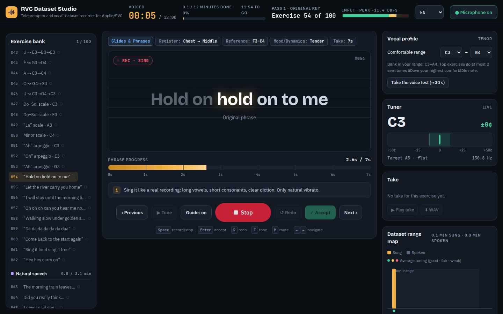
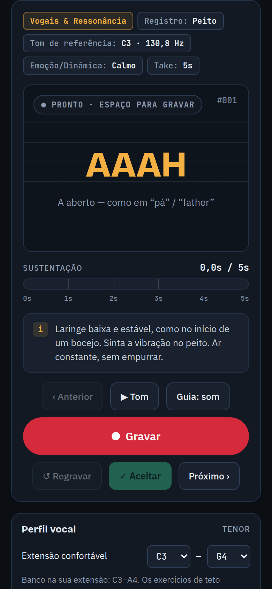

# RVC Dataset Studio

**Descubra seu perfil vocal e grave um dataset limpo para treinar o seu próprio modelo de voz no [Applio](https://github.com/IAHispano/Applio) / RVC — tudo no navegador.**

[English](README.md) · [Guia técnico](docs/GUIA.pt-BR.md) · [Adicionar um idioma](docs/LANGUAGE_PACKS.md) · [Contribuir](CONTRIBUTING.md)



- **Nenhum áudio sai do seu navegador.** Sem servidor, sem contas, sem cookies, sem analytics. Funciona offline depois da primeira visita.
- **Serve para qualquer voz.** Um teste de 30 segundos mede a sua extensão confortável e cada exercício é colocado dentro dela — do baixo ao soprano.
- **Equilíbrio de registros vocais.** Equilibra voz de peito, voz mista (passaggio) e falsete (voz de cabeça) para que o modelo de IA navegue transições suavemente sem esganar nem quebrar oitavas em agudos.
- **Calibração de ganho e headroom.** Teste de 5 segundos alerta contra saturação digital (> -1 dBFS) e excesso de ruído (< -24 dBFS) antes do início da gravação.
- **Feedback de afinação em tempo real.** Badge com cents e nota diretamente no prompter durante o take.
- **Confere cada take.** Voz ativa, pico e clipping, ruído de fundo e afinação, antes de você aceitar.
- **Mostra o que falta.** O mapa de extensão e as barras de registros mostram os segundos gravados por nota, porcentagens de cobertura e sugestões automáticas de exercícios.
- **Exportação pronta para o Applio.** Gera ZIP com WAVs limpos em 16/24 bits, README e `dataset_info.json` com hiperparâmetros sugeridos (RMVPE, index rate, taxa de amostragem, épocas).

> Projeto independente, sem afiliação com Applio, RVC, Suno ou serviços de geração de música.
> Grave e clone apenas **a sua própria voz**, ou uma voz que você tenha permissão clara para usar.



## Como funciona

1. **Comece pela sua voz.** Confirme que só vai gravar a sua voz (ou uma que você esteja autorizado a usar) e depois faça o teste de voz (sirene, fala, nota confortável), escolha um tipo de voz ou defina a extensão à mão. Escolha os idiomas em que você canta.
2. **Grave.** Com fones de ouvido fechados, aperte **Espaço**, respire durante a contagem e cante ou fale junto com o karaokê. O tom de referência toca a nota alvo e o afinador ao vivo mostra se você está perto.
3. **Revise.** Cada take passa por um controle de qualidade. **Enter** aceita, **R** regrava.
4. **Complete o que falta.** Acompanhe o mapa de extensão e mire em 10–15 minutos de voz ativa. Use **Minhas letras** para treinar linhas das suas músicas (fala, rápida, lenta e cantada) — elas ficam só no seu navegador.
5. **Exporte.** Baixe todos os takes num ZIP (um WAV por take e um README) ou num WAV contínuo, e treine no Applio.

Teclado: **Espaço** gravar/parar · **Enter** aceitar · **R** regravar · **T** tom de referência · **M** silenciar o guia · **← →** anterior/próximo.

## Levando o dataset para o Applio

1. Descompacte em `assets/datasets/NomeDaVoz` (sem espaços nem acentos no caminho).
2. **Preprocess** a 40 kHz ou 48 kHz (igual ao pré-treinado que você vai usar), com corte automático. O Applio corta os áudios de novo em pedaços curtos, então a duração de cada take só importa para o seu conforto.
3. **Extract** com o extrator de pitch `rmvpe` e o embedder `contentvec` (use o mesmo embedder depois, na conversão).
4. **Train** a partir de um pré-treinado, salvando um checkpoint a cada 10–50 épocas, e depois gere o índice. **Compare os checkpoints de ouvido** em vez de confiar num número fixo de épocas.

O [guia técnico](docs/GUIA.pt-BR.md) explica a técnica de gravação e os parâmetros de conversão (Protect, Index rate, formantes).

## Privacidade

Tudo é processado na página. Os takes ficam no IndexedDB do navegador; configurações e letras no localStorage. Nada é enviado. Veja a página **Privacidade** dentro do app (inclui RGPD/LGPD).

## Navegadores

Versões recentes do Chrome, Edge, Firefox e Safari (desktop e iOS). A gravação usa AudioWorklet, com ScriptProcessor como alternativa. O microfone exige HTTPS (ou `localhost`). Veja [docs/BROWSER_TESTING.md](docs/BROWSER_TESTING.md).

## Desenvolvimento

```sh
npm install
npm run dev          # http://localhost:5173
npm run check        # lint + tipos + validação do conteúdo + testes + build
```

Stack: Vite + TypeScript + Preact (com signals) + Tailwind compilado. Nenhum CDN em produção; as fontes são servidas pelo próprio site. A estrutura de pastas está no [README em inglês](README.md#development).

## Publicar

O site é totalmente estático. Na [Vercel](https://vercel.com): importe o repositório do GitHub e mantenha as configurações detectadas para Vite (build `npm run build`, saída `dist`). O `vercel.json` adiciona os headers de segurança: Content-Security-Policy estrita, `Permissions-Policy: microphone=(self)`, HSTS e sem cache para o service worker.

## Licença

Código: [MIT](LICENSE). Banco de exercícios e pacotes de idioma (`content/`, `schema/`): [CC0 1.0](content/LICENSE). Fontes incluídas: SIL Open Font License 1.1.
